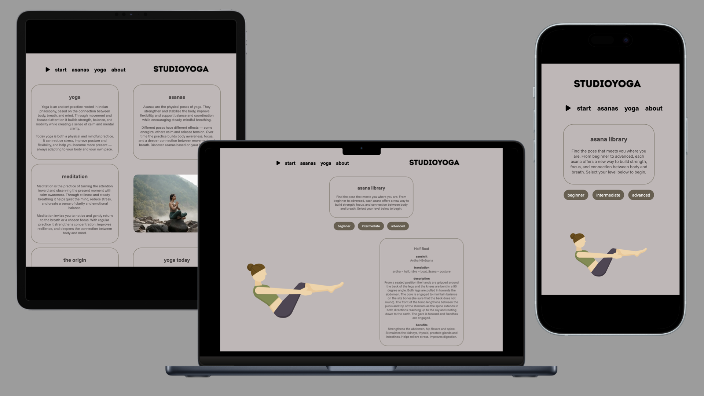

## StudioYoga app

My first React project, built with Vite at University West: an app for yogis

[Open the app](https://joystromer.github.io/portfolio/StudioYoga/index.html#/)

## What the app is about

StudioYoga is a yoga app where users can explore yoga poses (asanas) for three different levels. 
The app has several pages, a calm design and optional background music.

Your digital yoga companion, a place where you can explore poses, learn their names, and understand 
their benefits in a clear and simple way. Organized by level, from beginner to more advanced, 
it allows you to move at your own pace and find what suits your practice.

Whether you are looking for inspiration or a quick reminder, everything is designed 
to be easy to find and easy to follow.

## Features

- Explore yoga poses for three levels: beginner, intermediate and expert
- Read the names and benefits of each pose
- Navigate between pages: start, asanas, yoga and about
- Play or pause calming background music
- Learn how to step into your own yoga practice

## What I practiced

- Fetching data from an open API and displaying it in React
- Using React state and refs (`useState`, `useRef`) for the music player
- Routing between pages with React Router
- Building with Vite and deploying to GitHub Pages

## Built with 

- React
- Vite
- React Router
- HTML
- CSS
- Font Awesome icons

## Credits

- Yoga poses from [Yoga API](https://github.com/alexcumplido/yoga-api) by Alexandre C.
- Yoga icons created by [dDara](https://www.flaticon.com/free-icons/yoga) - Flaticon
